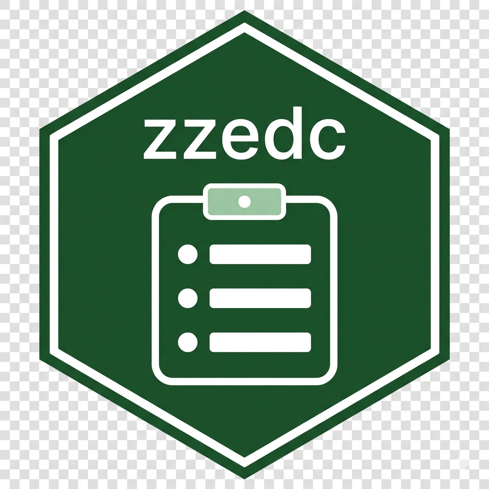

# ZZedc - Electronic Data Capture System <a href="https://github.com/rgt47/zzedc"></a>

<!-- badges: start -->
<!-- badges: end -->

The `zzedc` package provides a Shiny application for electronic data capture (EDC) in clinical trials and research studies, implemented using Bootstrap 5 components via bslib.

## System Features

- **Authentication system**: Role-based user access with credential management
- **Data entry interface**: Customizable forms with automated validation
- **Reporting functionality**: Data summarization, quality control metrics, and statistical reports
- **Data management**: Interactive data visualization, filtering, and subset extraction
- **Data export**: Multiple export formats including CSV, Excel, JSON, PDF, and HTML
- **Compliance tooling**: Electronic signatures and training-record tracking
- **Administration**: User management, audit-trail viewing, and backup/restore
- **Security profiles**: A `security.profile` setting (`development`,
  `standard`, or `regulated`) governs how the application reacts when
  storage cannot be shown to be encrypted at rest; see `?resolve_security_profile`
- **User interface**: Responsive design compatible with desktop and mobile devices
- **Data validation**: Real-time validation with immediate user feedback

## Installation

You can install the development version of zzedc from [GitHub](https://github.com/) with:

``` r
# install.packages("devtools")
devtools::install_github("rgt47/zzedc")
```

## Usage

To launch the interactive EDC application:

```r
library(zzedc)
launch_zzedc()
```

The application will open in your default web browser with the following interface components:

1. **Home**: Welcome dashboard with system overview and status indicators
2. **EDC**: Data entry forms with user authentication and access control
3. **Reports**: Reporting system including:
   - Basic data summaries
   - Data quality metrics
   - Statistical analysis with interactive tables
4. **Data Explorer**: Data management capabilities including:
   - File upload and processing
   - Missing data analysis
   - Interactive visualizations
5. **Export Center**: Data export functionality including:
   - Multiple format support
   - Batch export operations
   - Export templates and scheduling
6. **Compliance**: Electronic signatures and training-record tracking
7. **Admin**: User management, backup and restore, audit-trail viewing,
   and system configuration

## Application Architecture

### Technology Stack

- **UI Framework**: `bslib` (Bootstrap 5) with `bsicons`
- **Data Tables**: `DT` with filtering and sorting capabilities
- **Visualizations**: `ggplot2` and `plotly` for interactive visualizations
- **Authentication**: Custom secure login system
- **Data Storage**: File-based storage with SQLite support

### Package Structure

```
zzedc/
   DESCRIPTION              # Package metadata
   NAMESPACE               # Generated namespace
   README.md               # This file
   R/                      # Package functions
      launch_zzedc.R      # Main launcher function
      zzedc-package.R     # Package documentation
   ui.R                    # Bootstrap 5 user interface
   server.R                # Server logic
   global.R                # Global settings
   home.R                  # Home page components
   edc.R                   # EDC form logic
   auth.R                  # Authentication system
   savedata.R              # Data persistence
   report[1-3].R           # Report modules
   data.R                  # Data explorer
   export.R                # Export functionality
   forms/                  # Form definitions
   www/                    # Web assets
   tests/                  # Test suite
   credentials/            # User credentials
```

## Technical Implementation

This implementation incorporates modern R/Shiny development patterns including:

### User Interface Design
- Bootstrap 5 components for responsive layouts
- Modern card-based design patterns
- Consistent iconography using bsicons
- Value boxes for key metrics display
- Mobile-compatible responsive design

### Software Architecture
- Proper R package structure with DESCRIPTION file
- Roxygen2 documentation for all functions
- Modular code organization following R package best practices
- Explicit NAMESPACE with package imports
- Test suite with tinytest

### System Capabilities
- Full-screen expandable interface components
- Advanced data table functionality with DT
- Interactive tooltips and user interface elements
- Professional color schemes and typography
- Export templates and batch operations

## Example Workflow

1. Launch the application with `launch_zzedc()`
2. Login with appropriate user credentials
3. Navigate to the EDC tab for data entry
4. Use the Reports tab to monitor data quality
5. Access the Data Explorer for data management
6. Export results using the Export Center

## Dependencies

This package builds on several R packages:

- `shiny` - Web application framework
- `bslib` - Bootstrap 5 theming and components
- `bsicons` - Bootstrap icon library
- `DT` - Interactive data tables
- `ggplot2` and `plotly` - Data visualization
- `dplyr` - Data manipulation
- `jsonlite` - JSON processing

## Regulatory Compliance

No EDC software can itself 'be compliant' with 21 CFR Part 11, HIPAA,
or GDPR: those regimes govern the operating organization and the
individual study, not the software artifact. ZZedc provides technical
controls intended to support compliance workflows when the application
is deployed and configured appropriately; the deploying institution and
study team remain responsible for the surrounding procedures,
governance, and configuration. This three-layer structure (software
controls, institutional procedures, per-study configuration) is the
same one every comparable EDC platform's own compliance statement
ultimately resolves to.

Controls currently provided:

- **GDPR**: Data subject rights, consent management, audit logging
- **21 CFR Part 11**: Electronic signatures, audit trails, access
  controls, and a hash-chained audit log
- **Security profiles**: A `security.profile` setting
  (`development`, `standard`, or `regulated`) that decides whether
  storage which cannot be shown to be encrypted at rest is allowed,
  warned about, or refused; see `?resolve_security_profile`. At-rest
  encryption is currently verified by execution for the DuckDB
  backend only. SQLite is encrypted only when built against
  SQLCipher or SQLite3MultipleCiphers (stock CRAN RSQLite ignores
  the encryption key and stores plaintext); PostgreSQL, MySQL/MariaDB,
  and ClickHouse depend on server-side configuration that zzedc does
  not verify.

See `vignette("technical-lead-guide")` Appendix C for the current
implementation details and `NEWS.md` for the encryption and
security-profile changes made in this development cycle.

## Comparison to Other EDC Systems

Academic clinical trial groups most often use REDCap, with
OpenClinica, Castor EDC, and LibreClinica as the next tier of
self-hosted or low-cost alternatives. All of these are web
applications configured through a browser-based GUI, with
programmatic access, where offered, limited to an export API layered
on top. ZZedc is distributed as an R package: it is installed,
scripted, and tested with the same tools (`R CMD check`, `tinytest`,
`devtools`) a biostatistics group already uses for its analysis
code, which may suit groups whose technical staff are R-fluent
statisticians or data managers rather than web-application
administrators.

On encryption at rest, REDCap, OpenClinica's self-hosted Community
Edition, and LibreClinica all defer the question to infrastructure
the deploying institution must configure itself; none of them
verifies encryption at rest from within the application. ZZedc's
DuckDB backend verifies encryption at rest by execution at startup
under the `regulated` security profile, which is not yet the case
for its own SQLite, PostgreSQL, or MySQL/MariaDB backends. As with
every platform in this space, none of this amounts to a claim that
installing the software satisfies 21 CFR Part 11, HIPAA, or GDPR on
its own; see Regulatory Compliance above.

## Documentation

- `vignette("getting-started")` - Role-based entry point
- `vignette("content-author-guide")` - Setting up trial content
- `vignette("technical-lead-guide")` - Deployment and regulatory
  implementation details
- `vignette("backend-quickstart")` - Choosing and configuring a
  database backend
- `vignette("setup-wizard-guide")` - Guided setup for non-technical
  users
- `vignette("demonstration-trial-setup")` - Worked example with a
  demonstration trial
- `vignette("mysql-redcap-migration-roadmap")` - Migrating from
  REDCap

## Reproducibility

This package is developed using the zzcollab framework for reproducible
research. To reproduce the development environment:

```bash
git clone https://github.com/rgt47/zzedc.git
cd zzedc
make r  # Enter Docker container with all dependencies
```

## Contributing

Please report issues at: https://github.com/rgt47/zzedc/issues

## License

GPL-3

## Author

Ronald (Ryy) G. Thomas (rgthomas@ucsd.edu)
